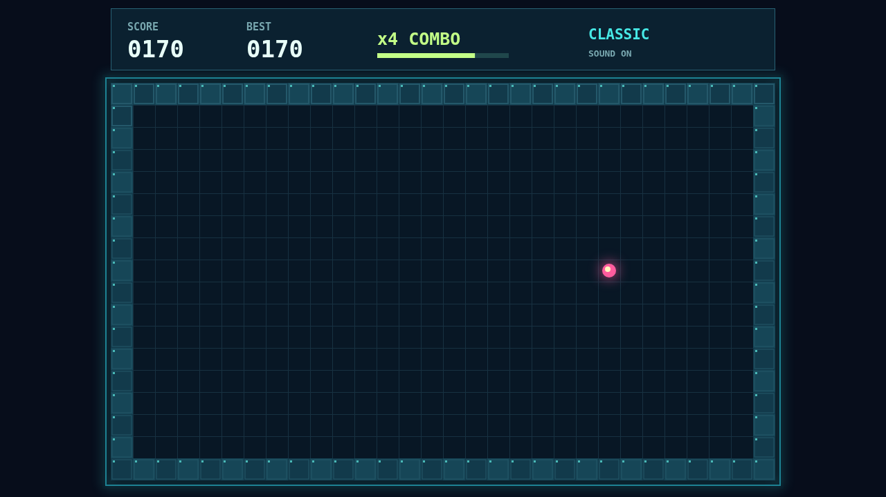

# Coil

A bright serpent moves across a dark, enclosed grid. Guide it toward the glowing pellet, then plan your next turn before it reaches a wall or its own tail.

Every pellet adds a cell to the coil and points to your score. The board gives you room at first, but each bite makes your route tighter.

Keep collecting quickly to climb from a simple score to a fivefold combo. A shrinking bar shows how long you have to reach the next pellet before the multiplier resets.

Play with the arrow keys or WASD. Pause when you need to think, then return to the exact moment you left.

